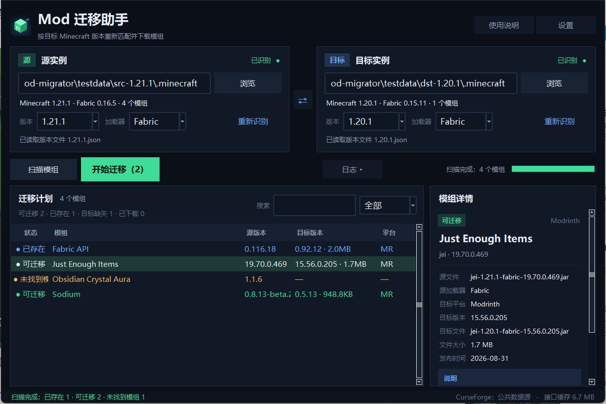

# Mod 迁移助手

按**目标 Minecraft 版本**重新匹配并下载整合包内容的 Windows 桌面工具，支持模组、资源包和光影。

它会读取两个 Minecraft Java 版实例：

1. **源实例**：读取 `mods`、`resourcepacks`、`shaderpacks` 文件夹，识别每个内容的名称、版本和加载器。
2. **目标实例**：读取目标实例的 Minecraft 版本与加载器（Fabric / Quilt / Forge / NeoForge）。
3. 到 **Modrinth** 查询每个项目，必要时回退到 **CurseForge**，寻找与目标版本匹配的文件。
4. 把能找到的内容下载到目标实例对应文件夹；资源包/光影没有目标版本时直接复制旧文件；找不到模组或目标版本的，会在下载前弹窗列出并询问是否跳过。
5. 迁移完成后会重新扫描目标实例的模组，自动补全 Modrinth 上标记为必需的前置依赖。



## 功能

- 自动识别常见实例目录：
  - 官方启动器 `.minecraft`（包括 `versions/<版本>/mods` 这种版本隔离布局；选择 `.minecraft` 时会自动定位带内容的版本）
  - `.minecraft/versions/<版本>` 版本隔离目录（保留你输入的具体版本路径，不再改写成 `.minecraft`）
  - Prism Launcher / MultiMC 实例（读取 `mmc-pack.json`）
  - CurseForge 实例（读取 `minecraftinstance.json`）
  - 通过 `launcher_profiles.json` 的 `lastUsed` / `selectedProfile` 推断版本
  - 支持 `26.3`、`26.2`、`26.1.x` 等新版本命名，以及 `26.3-Fabric 0.19.5`、`26.3-snapshot-7` 这类启动器版本 ID
- 解析 Fabric、Quilt、Forge、NeoForge 的模组元数据；元数据缺失时用文件名兜底。
- 读取资源包/光影 zip；有 `pack.mcmeta` 时解析描述与包格式，没有时也按文件名识别，不因为缺少 `pack.mcmeta` 而拒绝；同时支持版本隔离的 `resourcepacks` / `shaderpacks`。
- 优先用 SHA1 哈希在 Modrinth 精确命中源文件，命中失败再按名称/ID 搜索。
- 目标文件严格校验 Minecraft 版本与加载器（模组），资源包/光影只按 Minecraft 版本匹配，不区分光影加载器。
- 资源包/光影没有目标版本时，状态为“可复制”，迁移时直接复制源文件，不会因为平台缺版本而丢失。
- 迁移完成后重新扫描目标实例的模组，按 Modrinth 的 `required` 依赖关系递归补全缺失前置，并尽量下载。
- 下载时校验文件大小与 SHA1；使用 `.part` 临时文件，支持取消。
- 迁移计划表支持搜索、按类型/状态筛选、查看详情、打开项目页面。
- 迁移前确认无法迁移的项目；迁移后显示汇总，可导出 CSV。
- 设置项：CurseForge API Key、覆盖同名文件、自动打开目标文件夹、清理缓存。
- 附带命令行模式，便于批处理与自动化。

## 直接运行

### 使用打包好的程序

提供两种形式，二者都**自带 Python 3.12 运行时、Tcl/Tk 和 Pillow**，目标电脑不需要安装 Python：

- **单文件版**：双击 `dist\ModMigrator.exe`。所有运行时都封装在 exe 内，首次启动稍慢是解包所致。
- **文件夹便携版**：双击 `dist\ModMigrator-Portable\ModMigrator.exe`。Python 运行时位于 `_internal\python312.dll` 等文件中，启动更快，也便于检查依赖是否齐全；整个文件夹可复制到任意位置使用。

根目录的 `启动.bat` 会优先启动当前目录或 `dist` 下的 exe。

### 从源码运行

要求 Windows + Python 3.11 或更高版本（需包含 tkinter）。

```bat
pip install -r requirements.txt
python main.py
```

也可以双击 `启动.bat`。

## 使用步骤

1. 在左侧选择**源实例**目录，右侧选择**目标实例**目录。
   - 可以直接选择 `.minecraft`，也可以选择 `versions\1.21.1` 或 Prism/MultiMC 实例目录。
   - 识别后确认“版本”和“加载器”；识别不准时可手动修改，再点“重新识别”。
2. 点击**扫描实例**。程序会联网查询，首次扫描可能需要几十秒。
3. 查看迁移计划：
   - `可迁移`：找到目标版本，等待下载。
   - `可复制`：资源包/光影没有目标版本，迁移时直接复制源文件。
   - `已存在`：目标实例已有同一内容，不会重复下载/复制。
   - `无目标版本`：平台上有这个模组，但没有目标 MC 版本/加载器对应的文件。
   - `未找到模组`：Modrinth 和 CurseForge 都没有匹配到该模组。
   - `缺少前置`：依赖检查发现必需前置，但平台上没有可用的目标版本。
   - `跳过`：不是可识别的模组 jar，或资源包 zip 损坏。
   - `查询失败`：网络或平台接口报错。
4. 点击**开始迁移**。若有无法迁移的项目，会先弹出清单，窗口底部有**“继续并跳过”**和**“取消”**两个按钮；点继续后只下载/复制可迁移项。
5. 下载完成后会自动检查模组前置，补全缺失的必需依赖；最后查看汇总，可打开目标文件夹或导出 CSV 报告。

## CurseForge 说明

- 未配置 API Key 时，程序使用 [cfwidget](https://api.cfwidget.com/) 的公开数据。它没有搜索接口，只能根据模组 ID、Modrinth slug 或名称推测 CurseForge slug，因此**可能漏查**。
- 在“设置”里填入 CurseForge 官方 API Key 后，会改用官方搜索与文件接口，匹配更可靠。
- 查询策略是 **Modrinth 优先**：只有 Modrinth 没找到项目，或找到了项目但没有目标版本时，才自动查询 CurseForge，以减少请求、加快扫描。
- 详情页始终提供“在 CurseForge 搜索”链接，方便手动确认。
- CurseForge 上部分文件禁止第三方分发，下载会返回 403；这类文件需要到 CurseForge 页面手动下载。

## 命令行

```bat
python -m modmigrator --source "D:\MC\1.21.1\.minecraft" --target "D:\MC\1.20.1\.minecraft"
```

只扫描、不下载：

```bat
python -m modmigrator --source "源实例" --target "目标实例" --csv report.csv
```

扫描并下载/复制，自动跳过无法迁移的项目：

```bat
python -m modmigrator --source "源实例" --target "目标实例" --download --yes
```

常用参数：

| 参数 | 说明 |
| --- | --- |
| `--download` | 匹配后立即下载可迁移项目；无目标版本的资源包/光影会复制源文件 |
| `--yes` | 跳过确认，自动跳过无法迁移项（非交互环境必需） |
| `--overwrite` | 覆盖目标文件夹中的同名文件 |
| `--cf-key` | CurseForge 官方 API Key |
| `--no-cfwidget` | 禁用 cfwidget 公共数据源 |
| `--workers` | 并发查询数，默认 4 |
| `--csv` | 导出 CSV 报告 |
| `--json` | 以 JSON 输出扫描结果 |
| `--open` | 完成后打开目标实例目录 |

下载完成后，命令行与图形界面都会自动执行一次前置依赖检查。

## 打包

```bat
构建.bat
```

或手动执行：

```bat
pip install -r requirements-build.txt
python -m PyInstaller --noconfirm --clean build.spec
python -m PyInstaller --noconfirm --clean build-portable.spec
```

- `build.spec` 生成单文件版 `dist\ModMigrator.exe`。
- `build-portable.spec` 生成文件夹便携版 `dist\ModMigrator-Portable\`，Python 运行时位于 `_internal`。

两种产物都已内嵌图标与界面资源，目标电脑均无需安装 Python。

## 数据与日志

- 配置：`%APPDATA%\ModMigrator\config.json`
- 接口缓存：`%LOCALAPPDATA%\ModMigrator\cache`
- 日志：`%LOCALAPPDATA%\ModMigrator\logs\modmigrator.log`
- 设置中可清理接口缓存。

## 已知限制

- 迁移对象是 `mods` 中的 `.jar`，以及 `resourcepacks` / `shaderpacks` 中的 `.zip`；不迁移世界、配置和启动器设置。
- 资源包/光影没有统一的项目 ID，主要靠文件名和 `pack.mcmeta` 描述匹配平台项目；名称不规范时可能匹配不到，此时仍会按“复制旧文件”处理。
- 前置补全只读取 Modrinth 版本元数据中标记为 `required` 的依赖；Forge/NeoForge 很多前置关系不公开，仍需自行确认。
- 源模组若没有可识别的元数据，只能靠文件名搜索，可能误判。
- 同一模组在目标实例已有旧版本时，会标记“已存在”并跳过；需要更新时请先删除目标实例中的旧 jar，再重新扫描。覆盖选项只影响下载时的同名文件，不会让旧版本自动变成可迁移。
- 资源包/光影在目标实例已有同名内容时也会跳过；需要更新时请先删除旧文件。
- 模组/资源包作者未在 Modrinth/CurseForge 发布对应版本时，本工具无法凭空生成，只能提示跳过或复制旧文件。
- 下载源为平台 CDN，网络不稳定时可能失败；失败项目会在汇总中列出，并写入日志。

## 项目结构

```text
mod-migrator/
├─ main.py                 入口
├─ modmigrator/
│  ├─ __main__.py          日志与启动
│  ├─ cli.py               命令行
│  ├─ config.py            配置
│  ├─ dependencies.py      模组前置依赖检查与补全
│  ├─ matcher.py           扫描与匹配流水线
│  ├─ mcinstance.py        实例/版本识别
│  ├─ migrate.py           下载与复制
│  ├─ modjar.py            jar 元数据解析
│  ├─ models.py            数据模型
│  ├─ packs.py             资源包/光影 zip 解析
│  ├─ providers/           Modrinth / CurseForge / HTTP
│  └─ ui/                  Tkinter 界面
├─ tests/                  单元测试
├─ assets/                 图标与截图
├─ build.spec              PyInstaller 单文件配置
├─ build-portable.spec     PyInstaller 文件夹便携版配置
├─ requirements.txt
└─ 构建.bat / 启动.bat
```
